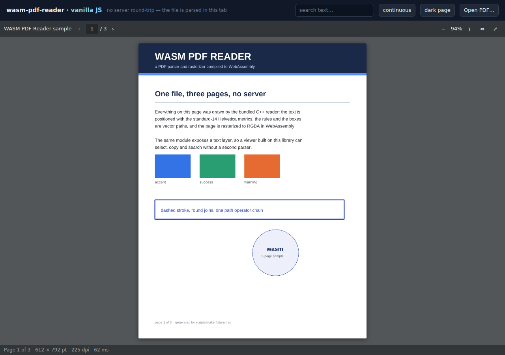
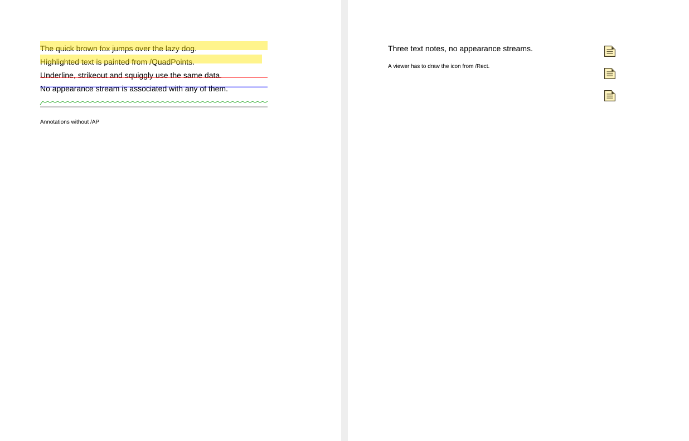
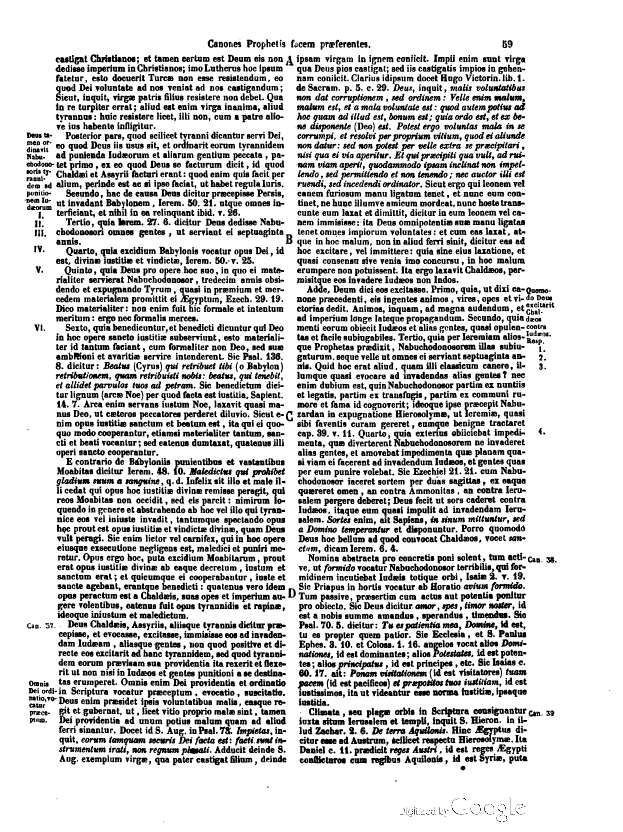
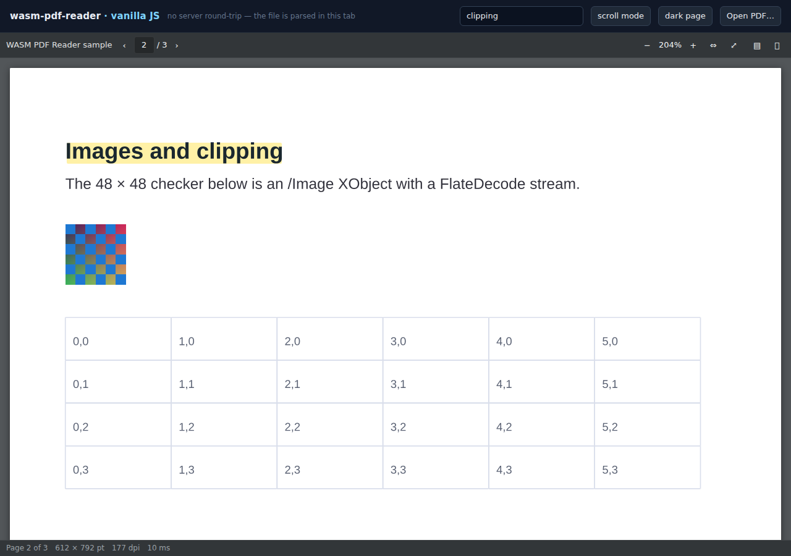
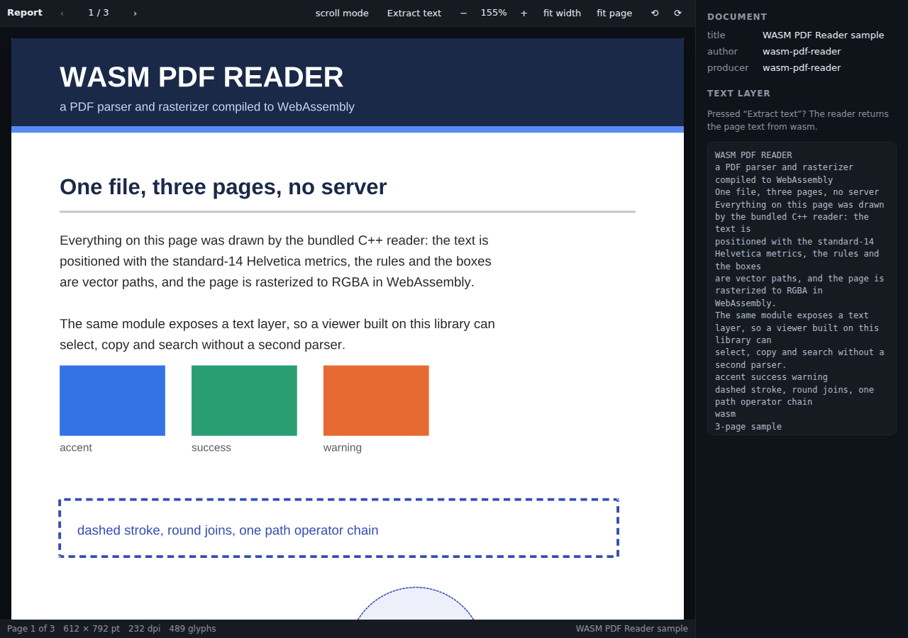
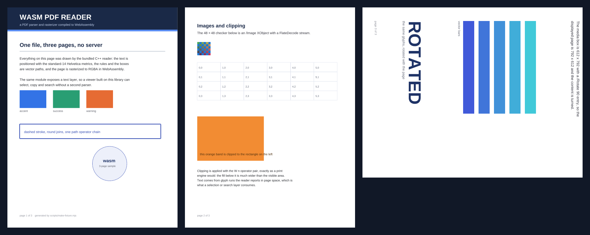

# wasm-pdf-reader

A PDF reader in WebAssembly: it parses, rasterizes and extracts text from a PDF
inside the browser tab. No server, no upload, no CDN — a 3.1 MB module (1.9 MB
gzipped, 0.9 MB of it the Adobe CMap tables) that a vanilla page or a React app
can drive.

Packaged as `@dionaditya/wasm-pdf-reader`. Try it without installing anything:
[vanilla demo](https://dionaditya.github.io/wasm-pdf-reader/vanilla/) ·
[React demo](https://dionaditya.github.io/wasm-pdf-reader/react/) ·
[ranged-loading demo](https://dionaditya.github.io/wasm-pdf-reader/ranged/).



The C++ core (lexer, xref, object streams, filters, content-stream interpreter,
scanline rasterizer, font subsetting) is the same code that powers the PDF tab
in [wasm-ui](https://github.com/dionaditya/wasm-ui), packaged here on its own.

## What it does

- **Parsing** — classic xref tables and xref streams, object streams, `/Prev`
  chains, incremental updates, xref rebuild for damaged files, Flate/LZW/
  ASCII85/ASCIIHex/RunLength with PNG and TIFF predictors. Object-stream offsets
  are read relative to `/First`, which is how calibre, Acrobat and Ghostscript
  write them.
- **Encryption** — Standard security handler: RC4 40/128-bit, AES-128 and
  AES-256 (R5/R6). Pass the password as an option and it is tried as the user
  password first, then as the owner password (R2–R4 via /O, R5/R6 via /OE with
  /Perms verification):

  ```js
  const doc = await PdfDocument.open(bytes, { password: 'secret' });
  ```

  Files with no password open with `PdfDocument.open(bytes)`. A file that needs
  one fails with `encrypted PDF: a user password is required` (or
  `wrong password`), never a blank page. The demo prompts for the password once
  when the reader asks for it.

  *Verified against qpdf:* `scripts/make_encrypted_fixtures.py` writes one file
  per revision (R2 RC4-40, R4 RC4-128, R4 AES-128, R5 and R6 AES-256, plus an
  owner-password-only file and one with a corrupted `/Perms`), and
  `scripts/verify_encryption.sh` compares the file key this engine derives with
  `qpdf --show-encryption --show-encryption-key`. All thirteen user/owner rows
  match byte-for-byte. Two behaviours are deliberate: an owner-only file opens
  with an empty password (that *is* its user password), and a corrupt `/Perms`
  makes the owner path refuse with a warning naming the permissions block —
  qpdf ignores it and opens anyway; refusing is the safer read of a tampered
  file.
- **Rendering** — paths, fills (nonzero/evenodd), strokes with dash/cap/join,
  clipping, text, Form and Image XObjects, inline images, `/Rotate` pages,
  axial and radial shadings, tiling patterns (`/PatternType 1`, cached per
  pattern and scale, clipped to the painted path), shading patterns, all 15 PDF
  blend modes, `/Group /Transparency` compositing with `/ca` and `/CA`,
  `/SMask` soft masks and `/Mask` stencil masks.
  Software rasterizer with 4× vertical supersampling, returning RGBA8.
  Images larger than the destination are box-averaged, so a 5000 px scan drawn
  at 600 px stays readable instead of aliasing.
- **Images** — Flate, DCT (JPEG), CCITT G3/G4 fax, JBIG2, and JPEG 2000 (see
  [Limits](#limits): the JPX path only handles some encoders).
  PDFium's JBIG2 and fax decoders are translated to C with `wasm2c` and linked
  into `pdf-reader.wasm`, so scans decode in the same pass as everything else —
  no second binary, no JS hand-off, no re-render. Stencil `/Mask` streams decode
  through the same path.
- **Colour** — DeviceGray/RGB/CMYK (CMYK through a 9^4 table calibrated against
  the reference renderer, because device CMYK has no profile of its own),
  ICCBased profiles (matrix/TRC and A2B0 LUTs), `/Separation` and `/DeviceN`
  spot inks through their tint transform (sampled, exponential or stitched
  function), `/Indexed`.
- **Fonts** — TrueType (`/FontFile2`), bare CFF and CID-keyed CFF, CFF inside
  an OpenType (`OTTO`) wrapper, and Type3 fonts whose glyphs are content
  streams
  (`/FontFile3 /Type1C`, `/CIDFontType0C`) through an own Type2 interpreter, and
  sfnt-wrapped `/OpenType`. CID fonts resolve glyphs through `/CIDToGIDMap` or
  the CFF charset, after the character code is turned into a CID by the font's
  `/Encoding`: `/Identity-H`, one of the 179 predefined Adobe CMaps
  (`/UniJIS-UCS2-H`, `/GBK-EUC-H`, `/90ms-RKSJ-H`, …) or an embedded CMap
  stream, including `/usecmap` inheritance and mixed 1/2-byte codespaces.
  Embedded subsets that ship without a `cmap` table (common for Arabic and CJK)
  are patched with a synthetic one instead of falling back to a substitute face.
  Advances come from `/W`, falling back to the face's `hmtx`.
- **Annotations** — link annotations (`/URI`, `/GoTo`, direct `/Dest` and named
  destinations) are exposed as data and rendered as clickable overlays; every
  other annotation is drawn from its `/AP` appearance stream, which is where
  signatures, stamps and meterai actually live. Markup annotations that ship
  without an appearance (the common case for highlight, underline, strikeout
  and squiggly) are synthesised from `/QuadPoints` and `/C`, including one mark
  per quad; `/Text` notes without an `/AP` icon get a note icon built from
  `/Rect`. An appearance stream always wins when present.
- **Optional content** — `/OCProperties` `/OFF`/`/ON` decide which OCGs paint;
  hidden `/OC ... BDC` sections and XObjects with an `/OC` entry are skipped.
- **Outline** — `document.outline` returns `[{title, page}]` for the bookmark
  tree.
- **AcroForm** — `document.form` lists `{name, type, value, page, rect}`;
  `document.setField(name, value)` writes `/V` (and `/AS`) in memory so the next
  render shows the change. Widgets that ship without an `/AP` stream get a
  synthesised appearance: background, border, value text and a tick for buttons.
- **Viewer chrome** — page rail with lazily rendered thumbnails and a print
  action that rasterizes every page at ~120 dpi into a detached sheet, prints it
  and discards it (no print stylesheet can reach into the host page).
- **View rotation** — ⟲ / ⟳ in both toolbars, `setRotation` / `rotateLeft` /
  `rotateRight` on the controller and `defaultRotation` on `PdfReader`, in 90°
  steps on top of each page's own `/Rotate`. The turn is a *view* transform: the
  page box swaps for 90°/270° and the layer holding canvas, text, links and
  highlights is rotated onto it, so nothing re-renders and every overlay stays
  registered. The page element itself stays axis-aligned, because the selection
  overlay is painted in screen coordinates relative to it.
- **Text layer** — glyph runs with page-space boxes, so you can select, copy,
  search and draw highlights without a second parser. The viewer mounts a
  transparent `.wpdf-textlayer` over the canvas (each run is a span, stretched
  to the width the engine measured), which makes drag-selection, Ctrl+C and the
  browser's own find-in-page work. Turn it off with `textLayer: false` if you
  only need pixels.
- **Web Worker mode** — `PdfDocument.open(bytes, { worker: true })` parses and
  rasterizes in a worker, so a heavy page cannot freeze the tab: the main thread
  only does `putImageData` on the pixels that come back (transferred, not
  copied). Geometry, metadata, outline and form fields are captured once at open
  so the layout API stays synchronous; `getText`/`getLinks` are pre-warmed by the
  render, `search()` returns a Promise. Both demos run this path by default, and
  `test/e2e.mjs` asserts it is actually taken. A worker that cannot start (no
  `Worker`, a 404 on `workerUrl`, a CSP that blocks it) falls back to the inline
  path and reports why on `document.workerError`.
- **Ranged loading** — a document does not have to be copied into wasm at all:
  `PdfDocument.open({ url, size }, { worker: true })` (or `{ blob }`) parses
  straight out of HTTP `Range` requests or Blob slices, with a 16 KB → 1 MB
  adaptive window. On the 117 MB / 240-page test fixture, opening, drawing page 1,
  page 240 and extracting text pulls **5.4 MB of 117 MB** and keeps the wasm heap
  at **16 MB**; a **1031 MB** / 240-page file opens ranged in **1.8 s** with
  **8.8 MB** fetched and the same 16 MB heap (a manual Chromium check, not a
  committed fixture). A server that ignores `Range` is survived by keeping the
  first full body and slicing it locally. Requires worker
  mode, because the reads are synchronous — that is the only way a synchronous
  lexer can page a file in — but a file above the inline copy budget (512 MB) is
  **routed through worker + ranged loading automatically**, even when
  `{ worker: true }` was not passed, because no other path can work. That needs a
  sliceable source (a `File`/`Blob` or a URL); a bare `ArrayBuffer` that large
  still fails with the "too large to copy" message.
- **Page cache** — rendered page bitmaps are kept in a byte-budgeted LRU
  (`pageCacheBytes`, default from `navigator.deviceMemory`, `pageCache: false` to
  disable), so returning to a scale already rendered is a bitmap copy rather than
  a re-interpretation. The visible page is pinned and never evicted. A *new*
  zoom scale still re-renders — that is the missing display list, not the cache.
- **No network** — the wasm binary loads from your own origin; the file never
  leaves the tab.

Not supported, and reported through `document.warnings` rather than silently
approximated: text shaping for scripts that are not stored pre-shaped (Arabic,
Indic), Type 1 PFB fonts (a substitute face is used), shading types 1, 6 and 7
(function shadings and Coons/tensor patch meshes), soft masks attached with
`gs /SMask` (an image's own `/SMask` and a group's `/ca`/`/BM` do work),
non-isolated transparency groups (they are composited isolated, which only
differs when the group relies on the page backdrop), vertical writing (`-V`
CMaps paint horizontally), XFA and form JavaScript (`/AA`), public-key
encryption, and a display list (a *new* zoom scale re-interprets the page; the
page cache only makes a scale you already rendered cheap). Mesh shadings 4 and 5
decode but are still experimental — see
[Limits](#limits). Outlines, AcroForm fields (readable and settable in memory)
and page thumbnails are supported. Annotations render and links are clickable,
but there is no panel for note text, and a highlight uses alpha rather than a
multiply blend, so overlapping marks darken instead of saturating.

## Rendered examples

Every image below is the engine's own output at scale 1 (72 dpi), not a
screenshot of another viewer.

**Annotations without appearance streams** — left: highlight (two quads),
underline, strikeout and squiggly painted from `/QuadPoints` + `/C`; right:
three `/Text` notes whose icon is built from `/Rect` alone:



**CJK through a predefined CMap** — `/Encoding /UniJIS-UCS2-H` mapping UCS-2
codes to Adobe-Japan1 CIDs, then `/CIDToGIDMap` to the embedded Noto subset.
Ink ratio 0.0047 against MuPDF's 0.0049, mean abs diff 0.08/255:


**JBIG2 scan** — a 19th-century two-column page decoded from a JBIG2 stream
with a global symbol dictionary, drawn at 1:1:



## Security notes

- **No `eval`, by construction.** Parsing and rasterizing are C++; no JavaScript
  is generated from document data, and the build sets `-s DYNAMIC_EXECUTION=0`
  so Emscripten cannot emit `eval`/`new Function` either. `dist/` contains
  neither, and neither appears as a string in `pdf-reader.wasm`.
- **CVE-2024-4367 (pdf.js `/FontMatrix` injection) does not apply.** That bug
  exists because pdf.js compiled glyph commands into JS source; we interpret
  Type 1/Type 2 charstrings in C++ and read `/FontMatrix` entries as doubles.
  Checked against the Codean Labs PoC: the file opens, renders, raises no
  warnings, and executes nothing.
- **Bounds instead of trust.** Page bitmaps are capped at 40 MP, images at
  20000 px per side, form nesting at depth 6, the page tree at depth 40 / 5000
  pages, the outline at depth 64 / 5000 items, and every number read from the
  file goes through one `objNum` coercion. The failure mode for hostile input
  is a refused page, not code execution.
- **Cyclic structure is detected, not followed.** A `/Kids`, `/First` or `/Next`
  that points back up its own tree is skipped by a visited set rather than
  re-descended. That is the same class as CVE-2025-46206 (mupdf < 1.26.2,
  infinite recursion in `strip_outline()` on cyclic `/Next`), in our own code.
  `test/fixtures/outline-cycle.pdf` (generated by
  `scripts/make_outline_cycle_fixture.py`) is asserted in `test/unit.mjs`: it
  opens to 1 page instead of 40, and `document.outline` returns in ~1 ms instead
  of never returning.

## Limits

- **The whole file is resident unless you ask for otherwise.** The inline path
  copies the PDF into the wasm heap while it is open (plus parsed objects and,
  per page, one RGBA bitmap — measured: a 78 MB / 16-page JPEG scan opens and
  draws its first page in ~0.8 s on desktop). `{ worker: true }` plus a ranged
  source (`{ url, size }` / `{ blob }`) holds a window instead: 16 MB of heap for
  a 117 MB file, 5.4 MB fetched to draw two distant pages. What is *not* free:
  the worker still reads every page dict at open to fill its geometry snapshot,
  which costs ~3 s over HTTP on a 240-page document (one range request per page
  dict). Batch the page-tree read before shipping that to a slow origin.
- **The wasm heap only grows.** Emscripten cannot return memory to the OS, so the
  figure you see is a high-water mark for the module's lifetime; tearing the
  module down (`resetModule()`) frees it. `npm run test:memory` asserts it
  plateaus rather than climbing per render or per open/close. Measured on a
  JBIG2 sheet at 2x: 112 MB, no drift over rounds. The first JBIG2 image
  pre-grows the heap by 64 MB (the decoder's allocator is safest when it has
  headroom before a decode), and pages are decoded into one reusable RGBA
  buffer, so peak per render is about two page bitmaps, not one per page.
- **The heap is capped at 1 GiB** (`-sMAXIMUM_MEMORY=1073741824`). A 4 GiB
  ceiling looked harmless and broke phones: iOS refuses to grow a module that
  has asked to reserve that much address space, so allocation failed early with
  a misleading `out of memory`. The inline path therefore refuses to copy a file
  larger than **512 MB** (half the ceiling, because a render needs headroom on
  top of the file) *before* it grows the heap, and says what to do instead:

  - `wasm-pdf-reader: this PDF is 1031.3 MB — too large to copy into the
    WebAssembly heap (1024.0 MB ceiling). Open it with ranged loading instead…`
  - `wasm-pdf-reader: this PDF is 120.0 MB and the WebAssembly heap could not
    grow past 16 MB (its ceiling is 1024.0 MB). Mobile browsers — iOS in
    particular — cap wasm memory well below that…`

  A file above the copy budget is opened through worker + ranged loading
  automatically, even if `{ worker: true }` was not passed, because that is the
  only path that can work.
- **A 4 GB file is an offset problem, not a heap one — and the offsets are
  64-bit now.** wasm32's entire address space is 4 GiB, so no heap flag can hold
  the file; ranged loading never needs to. Every offset that used to be 32-bit is
  widened: `ByteSource::size`/`fetch`, the xref table, the lexer's position, and
  `startxref` (which was parsed with `atol()` and wrapped above 2 GiB, reporting a
  2.1 GB file as damaged). The offset crosses to JS as two i32 halves —
  `hi * 2^32 + lo`, still one exact Number — rather than as an i64 parameter that
  would force BigInt on every read. Measured in Chromium on a **sparse 3.999 GiB**
  fixture whose objects sit in the last kilobyte: 1 page, **80 KB fetched in 4
  range requests**, **16 MB heap**, 226 ms. Above 4 GiB the open is refused by
  name instead of truncating to size 0: `file is larger than 4 GiB, which is the
  ranged reader's limit`. `npm run test:ranged4g` holds it down.
- **One page, 40 MP.** A page is rendered whole, so `scale` is bounded by pixel
  count: 40 MP is the ceiling (a 10000×10000 px page is refused). Failures say
  which limit they hit:
  - `render failed: page needs 10000x10000 px (100.0 MP) at this scale; the
    renderer caps a page at 40 MP`
  - `render failed: not enough memory for a 6000x8000 px page (183 MB); the wasm
    heap could not grow`
- **JPEG 2000 covers one encoder so far.** The bundled JPX decoder renders the
  pdf.js reference fixture correctly, but a codestream written by OpenJPEG —
  what Pillow and most converters emit — decodes to noise: a flat-colour
  64x48 image differs from MuPDF by 14/255 and a grey ramp by 74/255, while the
  same images as JPEG, CCITT or JBIG2 match to ~2/255. Fixable; until then do
  not trust `/JPXDecode` pages.
- **Mesh shadings 4/5 are experimental.** The triangles fill, but neither type
  is verified: on `test/fixtures/mesh.pdf` the type 4 page is malformed (it
  omits the per-vertex edge flag), so MuPDF paints nothing and our gradient only
  proves we are more permissive; the type 5 lattice disagrees with MuPDF by
  87/255 because the cells are connected in the wrong order. Types 1 (function
  shading), 6 (Coons) and 7 (tensor) are unimplemented and raise a warning. See
  M4 in [`ROADMAP.md`](ROADMAP.md).
- **Encrypted files need their password up front.** There is no callback asking
  the handler for one mid-parse; pass `password` to `open()` (the demo prompts
  once and retries).

## How it compares: pdf.js and MuPDF.js

The scores below are generated by `node scripts/competitive-parity.mjs`, which is
the source of truth: 15 areas weighted for a document *viewer* (what a host app
embeds), each score tied to a named missing capability, so a number moves only
when the capability does. Referenced builds: pdf.js 6.4.299, MuPDF.js 1.28.1.

This is a capability count, not a speed or fidelity benchmark. Against the
*native* rasterizers (Ghostscript, MuPDF, Pdfium, Xpdf, the Java engines) the
only serious public study is Alfresco's 2018 eight-engine comparison — what it
says, what does not transfer to a browser engine, our measured ms/page per
fixture and the four cells where we would score at the bottom are in
[`docs/BENCHMARK.md`](docs/BENCHMARK.md). Reproduce the throughput with
`node scripts/bench.mjs`.

### Capability parity

| Area | Weight | This engine | pdf.js | MuPDF.js |
| --- | ---: | ---: | ---: | ---: |
| Parsing, xref, object streams, damaged files | 8% | 92% | 100% | 100% |
| Encryption (Standard handler R2–R6) | 5% | 92% | 85% | 100% |
| Image codecs (Flate/DCT/CCITT/JBIG2/JPX) | 8% | 85% | 100% | 100% |
| Colour management (ICC, spot, DeviceN) | 7% | 70% | 85% | 100% |
| Fonts and encodings (TT, CFF/CID, CMaps, Type3) | 10% | 80% | 90% | 95% |
| Content stream: paths, clips, blend, transparency | 10% | 90% | 95% | 100% |
| Shadings (types 1–7) | 5% | 40% | 100% | 100% |
| Tiling patterns, images, masks | 5% | 90% | 95% | 100% |
| Annotations (render, links, markup) | 6% | 75% | 95% | 95% |
| Forms (AcroForm read, fill, save) | 6% | 45% | 90% | 100% |
| Text extraction and structure | 6% | 78% | 95% | 100% |
| Viewer UX (toolbar, rail, search, print) | 8% | 78% | 100% | 50% |
| Accessibility (tagged PDF, screen readers) | 5% | 20% | 90% | 35% |
| Architecture (worker, ranged loading, cache) | 6% | 85% | 100% | 80% |
| Ecosystem (release, docs, integrations, testing) | 5% | 30% | 100% | 90% |
| **Weighted total** | **100%** | **73%** | **95%** | **90%** |

**Parity: 77 % of pdf.js, 81 % of MuPDF.js** (weighted score 72.9 of 100; pdf.js
94.8, MuPDF.js 90.3). Not a benchmark: a capability count. It says nothing about
speed on a specific file — that needs the 30-document pilot described in
[Embedding in a host app](#embedding-in-a-host-app).

### What the numbers mean for a host app

- **Text documents are already at parity.** Parsing, encryption, fonts (including
  CJK CMaps), text extraction and the text layer are all in the high 80s–90s.
  A contract, an invoice, a scanned letter: a swap is defensible today.
- **The losses cluster in three places.** *Visually heavy* documents (shadings
  40 %, ICC 70 %, JPX 85 %), *interactive* ones (forms 45 %, annotations 75 %),
  and *non-visual* ones (accessibility 20 %, architecture 85 %).
- **MuPDF.js loses where pdf.js wins and vice versa.** MuPDF.js has no viewer at
  all (50 % viewer UX, 35 % a11y) but beats everything on decoding and can edit
  and write. pdf.js still leads on accessibility and the display list; its
  architecture edge closed with M9.1 (worker), M9.2 (ranged loading) and M9.3
  (page cache).
- **Interop reality:** `mupdf` 1.28.1 is **AGPL-3.0-or-later** (14.3 MB unpacked,
  commercial licence sold separately); `pdfjs-dist` 6.4.299 is Apache-2.0
  (34.9 MB unpacked: several builds, CMaps, standard fonts, two extra wasm
  modules); this package is **MIT** and 3.1 MB of wasm with no side modules.

### Where this engine is ahead, and stays ahead

- **No dynamic execution, by construction.** `-s DYNAMIC_EXECUTION=0`, and no
  document data ever becomes JavaScript — that is why CVE-2024-4367 cannot exist
  here, and a `grep` for `eval` / `new Function` in `dist/` is part of the test
  suite.
- **One module, one pass.** JBIG2 and fax are linked into `pdf-reader.wasm`, not
  a second binary with an async hand-off; a scanned page decodes in the same
  render as everything else.
- **Encryption keys verified against qpdf**, per revision, in CI — not "we
  support AES-256" on faith.
- **Deterministic pixels.** A per-page screenshot hash is committed, so a
  rasterizer regression fails the build.
- **Size:** half of MuPDF.js unpacked, a tenth of pdf.js, with the viewer included.

### Where it is behind, and by how much

Everything left, priced in points of the same weighted score (that is what the
`+points` column adds to 72.9):

| Remaining item | +points | Result | Effort | Why it matters |
| --- | ---: | ---: | --- | --- |
| Shadings 1/6/7 and a verified 4/5 | +2.8 | 95% | 3–5 days | gradient-heavy marketing PDFs currently lose their background |
| Forms: input overlay, /AP regeneration, save/flatten | +2.4 | 85% | 1–2 weeks | a filled field under a real producer's /AP still looks empty |
| Accessibility: tagged structure tree, roles, read order | +2.3 | 65% | 2–3 weeks | the text layer is selectable but not navigable by a screen reader |
| Ecosystem: publish 0.3.0, docs site, framework examples, CI matrix | +1.8 | 65% | 1 week + ongoing | registry is stale, and there is no fuzzing or disclosure pipeline |
| ICC for fills via lcms2 | +1.4 | 90% | 3–4 days | print-derived CMYK art is visibly off next to MuPDF |
| JPEG 2000: vendor openjpeg's j2k decoder | +1.2 | 100% | 3–5 days | the only output that is garbage rather than merely off |
| Type1 PFB, vertical CMaps, no-shaped-fallback warning | +1.2 | 92% | 4–6 days | legacy TeX output and Japanese vertical text fall back to a substitute face |
| Viewer UX: outline panel, zoom presets, gestures | +1.1 | 92% | 1 week | the chrome is the first thing a reviewer compares against pdf.js |
| Display list (M9.3 remainder) | +0.9 | 100% | ~1 week | a new zoom scale re-interprets the page; the cache only covers scales already rendered |
| Annotations: note panel, multiply highlights, authoring | +0.9 | 90% | 1 week | review workflows stop at "markup renders" |
| Text structure: lines/blocks, /ToUnicode policy, document index | +0.8 | 92% | 3–4 days | every pdf.js consumer expects line/block grouping |
| Encryption: public-key handler, onPassword retry | +0.3 | 97% | 2–3 days | rare, but a hard fail when a host meets a /Adobe.PubSec file |
| **All of the above** | **+17.0** | **90%** |  | **95% of pdf.js, 100% of MuPDF.js** |

Two things do not move with any of that: **writing** (editing, redaction,
signing) and **full accessibility certification**. The first is a declared
non-goal; the second is 2–3 weeks of structure-tree work and then an audit, and
no weight in this table can make it disappear. If your deployment has a VPAT
requirement, pdf.js is the answer, full stop.

Regenerate the table after a milestone and paste it in — do not hand-edit:

```bash
node scripts/competitive-parity.mjs
```

## Roadmap

[`ROADMAP.md`](ROADMAP.md) is the ordered gap list to MuPDF-grade output, with
touchpoints, fixtures and acceptance numbers.

- **M1–M8 are done** (ICC parsing, tiling patterns, blend modes and transparency
  groups, mesh 4/5, Separation/DeviceN, Type3 and `OTTO`-wrapped CFF, OCG
  visibility, AcroForm fields, outline, thumbnails, print). What is left of them
  is residue, not scope: full ICC for fills, shadings types 1/6/7, the JPEG 2000
  decoder (OpenJPEG codestreams decode to noise), Type1 PFB, `gs /SMask`, and the
  form-field repaint.
- **M9.1 (worker), M9.2 (ranged loading) and M9.3's page cache are done.** What
  is left of M9 is the **display list** — the record/replay split that makes a
  *new* zoom scale cheap; the cache only covers scales already rendered. That is
  the next thing to do, and its acceptance lines are in the roadmap. View
  rotation, ⟲ / ⟳ and the page rail landed alongside but are viewer chrome, not
  part of M9.
- **Non-goals** — shaping, writing, OCR, other input formats — are listed there
  too; they are what keeps this a reader rather than a PDF suite.

## Install

```bash
npm install @dionaditya/wasm-pdf-reader
```

The registry carries `0.1.0`. This repository is the source of truth and is at
`0.3.0` — tiling patterns, blend modes and transparency groups,
Separation/DeviceN, Type3 and CMap fonts, OCG and AcroForm, the outline and the
page rail; `npm publish` pushes it. To track the repository instead of the
registry, install from a commit — the
built `dist/`, wasm included, is committed, so nothing is compiled on install:

```bash
npm install github:dionaditya/wasm-pdf-reader
```

ESM only. The wasm glue is a sibling of `pdf-reader.wasm`, so Vite, webpack and
esbuild pick up both automatically.

## Use it from plain JavaScript

Framework recipes — Vite, Next.js, webpack/CRA, Vue, Svelte, Angular, plain script
tags, CDN, workers, CSP and the asset-resolution pitfalls — are in
[`docs/INTEGRATION.md`](docs/INTEGRATION.md). The short version:

```js
import { PdfDocument, mountPdfReader } from '@dionaditya/wasm-pdf-reader';
import '@dionaditya/wasm-pdf-reader/styles.css';

// 1. the whole viewer, toolbar included
const viewer = mountPdfReader('#viewer', {
  file: '/contracts/lease.pdf',   // ArrayBuffer, Blob, File, URL or Response
  fit: 'width',                   // 'width' | 'page' | 'none'
  theme: { bg: '#0b0f19', accent: '#7dd3fc' },
});
viewer.goToPage(2);
await viewer.search('deposit');   // Promise on a worker-backed document

// 2. or just the pixels, and draw them yourself
const doc = await PdfDocument.open(file);
const { imageData } = await doc.render(0, { scale: 2, dpr: devicePixelRatio });
const text = doc.getPageText(0);
doc.close();
```

Threaded — same code, the engine runs in a worker:

```js
const doc = await PdfDocument.open(file, { worker: true, wasmUrl: '/pkg/pdf-reader.wasm' });
await doc.renderToCanvas(canvas, 0, { scale: 2, dpr: devicePixelRatio });
const hits = await doc.search('deposit');      // Promise in worker mode
doc.close();                                   // terminates the worker
```

`{ worker: 'strict' }` throws instead of falling back when no worker can start.
`workerUrl` matters for bundled hosts: the default resolves next to the library,
and a bundler's `import.meta.url` is the page, so point it at the deployed
`dist/worker.js` (see [`docs/INTEGRATION.md`](docs/INTEGRATION.md#web-worker-mode)).



## Use it from React

```jsx
import { PdfReader } from '@dionaditya/wasm-pdf-reader/react';
import '@dionaditya/wasm-pdf-reader/styles.css';

export default function Preview({ file }) {
  return (
    <PdfReader
      file={file}
      fit="width"
      onPageChange={(page) => console.log(page)}
      toolbar={(api) => <MyToolbar {...api} />}
    />
  );
}
```



### What you can change

| prop | what it does |
|---|---|
| `file` | document source: `ArrayBuffer`, `Uint8Array`, `Blob`/`File`, URL, `Response` |
| `page` / `defaultPage` | controlled or uncontrolled page (zero-based) |
| `scale` / `defaultScale` / `fit` | controlled zoom, or `fit="width" \| "page"` |
| `defaultRotation` / `onRotationChange` | 90° view rotation on top of each page's `/Rotate`; the toolbar has ⟲ / ⟳ |
| `continuous` | stack all pages and render them lazily (IntersectionObserver) |
| `toolbar` | `false`, a node, or `(api) => node` |
| `components` | replace `Page` and `Toolbar` with your own components |
| `theme` | CSS variables: `bg`, `toolbarBg`, `accent`, `radius`, `pageShadow`, … |
| `pageOverlay` | `(page, { document, scale }) => node` — your own overlays |
| `onLink` | `(link, { document, goToPage, pageCount }) => boolean \| void` — link clicks; return `false` to keep the default |
| `search` | a query; matching lines get highlight rectangles |
| `pixelTransform` | post-process the RGBA of every page (invert, tint, watermark) |
| `renderer` | swap the rendering backend entirely (`{ render(doc, page, opts) }`) |
| `renderLoading` / `renderError` / `renderEmpty` | replace the built-in states |

The hooks underneath are public: `usePdfDocument`, `usePdfPage`, `useInView`.
The core has no React dependency at all, and the components are just one way to
lay it out.

## Embedding in a host app

The bundle is plain ESM plus one `.wasm` sibling, so a host that ships static
assets can vendor it with no build step:

- **ownCloud Classic** — [`dionaditya/owncloud_files_pdfviewer`](https://github.com/dionaditya/owncloud_files_pdfviewer)
  (branch `feat/replace-pdfjs`) replaces the PDF.js viewer with this engine. The
  route, the `?file=` contract and the CSP stay the app's; parsing, rasterizing,
  text and annotations are the engine's. The bundle is vendored under
  `js/vendor/wasm-pdf-reader/` with a `VERSION.json` recording this repo's commit
  and a per-file sha256, refreshed by `npm run sync-viewer` (see that directory's
  README). `scripts/sync-viewer.mjs` there is the template for any host that
  wants "pinned, traceable, no install-time build".
- **Any page** — `mountPdfReader('#viewer', { file: url })` for the full viewer,
  or `PdfDocument.open(bytes)` for pixels and text only. Serve
  `dist/wasm/pdf-reader.wasm` beside `dist/loader.js`; a CSP needs
  `script-src 'wasm-unsafe-eval'`.

## API

```js
PdfDocument.open(source, { wasmUrl, wasmBinary, module, filename, password,
                           worker, workerUrl, workerFactory,
                           pageCache, pageCacheBytes })
  .openRanged({ url, size } | { blob }, opts)        // no copy into wasm (M9.2)
  .mode                            // 'inline' | 'worker'
  .isWorker                        // boolean
  .workerError                     // Error | null — why a worker fallback happened
  .ranged                          // true when the file is read on demand
  .pageCount                       // number
  .metadata                        // { Title, Author, Subject, Producer, ... }
  .warnings                        // ["rebuilt xref", ...]
  .getPageSize(i)                  // { width, height, rotation, boxX0, boxY0 }
  .render(i, { scale, dpr, pixelTransform, stats })  // { imageData, width, height, ... }
  .renderToCanvas(canvas, i, opts)
  .getText(i)                      // [{ text, x0, y0, x1, y1, ox, oy, adv, fs }]
  .loadText(i) / .loadLinks(i)     // async, for worker documents
  .getPageText(i) / .getAllText()
  .getLinks(i)                     // [{ x0, y0, x1, y1, uri?, page? }]
  .search(query, { caseSensitive, limit, pages })    // [{ page, index, length, line, rects }]
  .boxToCss(box, i, scale)         // for overlays
  .pinPage(i, scale, dpr)          // keep this bitmap across cache eviction
  .rotation                        // view rotation, 0/90/180/270 (viewer controller)
  .setRotation(deg) / .rotateLeft() / .rotateRight()   // no re-render; a view transform
  .cacheStats                      // { entries, bytes, budget, hits, misses, evictions }
  .sourceStats                     // { fetched, fetches, windowBytes }
  .clearPageCache()
  .close()
```

A worker document (`open(..., { worker: true })`) has the same shape, except that
`search`, `setField`, `getPageText` and `getAllText` return Promises, and
`getText`/`getLinks` are only warm for a page that has been rendered (use
`loadText`/`loadLinks` otherwise). `doc.stats()` reports the worker's wasm heap
and how many bytes the parser actually read. A ranged source
(`{ url, size }` / `{ blob }`) additionally requires `worker: true` — see
[docs/INTEGRATION.md](docs/INTEGRATION.md#ranged-loading-big-files-no-copy).

Full types ship with the package (`dist/index.d.ts`, `dist/react/index.d.ts`).

## Demo

```bash
npm install
node examples/build-react.mjs     # bundles the React demo
node examples/server.mjs 4444      # http://localhost:4444/
```

- `http://localhost:5177/examples/vanilla/`
- `http://localhost:5177/examples/react/`
- `http://localhost:5177/examples/ranged/` — opens a 117 MB fixture through
  `Range` requests and reports the bytes actually read (see below)

The port is an argument: `node examples/server.mjs 4444` moves all three (the
server serves the repo root, so `/test/fixtures/*` works locally but not on the
published site). The GitHub Pages build (`npm run build:demo` → `_site/`) is
published from the **`gh-pages` branch**, not by an Actions workflow — the
workflow that tried the other way was removed because the repository's Pages
source is the branch. The recipe is in [docs/DEPLOY.md](docs/DEPLOY.md), and the
published site carries the same three demos under a sub-path, including
[/ranged/](https://dionaditya.github.io/wasm-pdf-reader/ranged/).



## Build from source

Requirements: [emsdk](https://emscripten.org/docs/getting_started/downloads.html)
on `PATH` and Node 18+.

```bash
. ~/emsdk/emsdk_env.sh
npm install
./build.sh            # C++ -> dist/wasm/pdf-reader.mjs + pdf-reader.wasm
npm run build:js      # src/js -> dist/ (ESM, plus JSX -> JS for React)
```

`dist/wasm` is committed, so `npm install` and CI work without emsdk; rerun
`./build.sh` only when the C++ changes.

## Tests

```bash
npm test              # core: parse, raster, text, search, links, annotations, CMaps, encryption (76 checks)
npm run test:e2e      # headless Chrome: 20 steps — both demos, worker mode, rotation, cache, pixel baseline
npm run test:pages    # the Pages build under a /wasm-pdf-reader/ base path
npm run test:ranged   # 117 MB fixture: ranged open, fetch budget, cache budget (10 steps)
npm run test:ranged4g # sparse 4 GiB fixture: offsets past 2^32, fetch budget, the 4 GiB refusal (6 steps)
npm run test:memory   # soak the heap: render, reopen, extract; assert it plateaus
scripts/verify_encryption.sh   # keys vs qpdf for every revision (needs qpdf)
npm run test:visual   # rewrite the pixel baseline after an intended change
```

`test:unit` runs the real wasm module in Node against generated fixtures
(including encrypted RC4/AES-128/AES-256 files — with and without passwords —
and a JBIG2 scan) plus:
`scripts/make-fixture.mjs` (three pages with text, vector art, an image XObject,
clipping and a `/Rotate 90` page) and `scripts/make-objstm-fixture.mjs`, a
calibre-shaped document whose catalog, page tree and font live in an object
stream with a non-zero `/First` and whose xref is an `/XRef` stream with a PNG
predictor. `test:e2e` drives the vanilla and React demos over CDP, asserts ink
coverage and navigation, hashes each page bitmap, and writes the screenshots in
`docs/screenshots/`.

## Working on the code

- [`CLAUDE.md`](CLAUDE.md) — the operating manual for an agent or a new
  maintainer: build and test loop, how to run the e2e suite and read its failures,
  a one-line brief on every file, the invariants that bite, the definition of done
  for a milestone, and the deploy procedure.
- [`ROADMAP.md`](ROADMAP.md) — what is left, in order, with acceptance numbers.
- [`docs/INTEGRATION.md`](docs/INTEGRATION.md) — how to embed it in any JS project
  or React app.
- `node scripts/competitive-parity.mjs` — regenerates the comparison tables above.

## Layout

```
src/cpp/            reader + rasterizer, CFF/Type2, JPEG 2000, annotations, C ABI
src/cpp/pdfsource.hpp  byte source: whole file in memory, or a slid window
src/cpp/jbig2gen/   PDFium JBIG2/fax decoder, generated from wasm by wasm2c
src/js/             loader, PdfDocument, worker + range source, page cache,
                    vanilla viewer, text helpers
src/js/react/       PdfReader, PdfPage, PdfToolbar, hooks
src/types/          hand-written .d.ts for both entry points
scripts/            fixture generators, JS build, demo build, bench
examples/           vanilla and React demos + static server (Range-aware)
test/               unit, e2e (CDP), Pages, ranged, fixtures, baseline
dist/               published output (ESM + wasm)
```

## Licence

MIT for this library. The engine's ~6,500 first-party lines sit on large vendored
and generated components: PDFium's JBIG2/fax (Apache-2.0), nanopdf's JPEG 2000
and CFF tables (Apache-2.0), `stb_truetype`/`stb_image` (MIT / public domain),
wabt (BSD-2), `simde` (MIT), Adobe's CMaps (BSD-3), and eight metric-compatible
font families — DejaVu (Bitstream Vera licence) and Liberation/Carlito/Caladea
(SIL OFL-1.1, subsetted, so Modified Versions).

[THIRD-PARTY.md](THIRD-PARTY.md) maps every file to its licence and states the
split by line count; the full OFL-1.1 and Bitstream Vera texts are in
`LICENSES/`, because those fonts ship inside `pdf-reader.wasm`.
